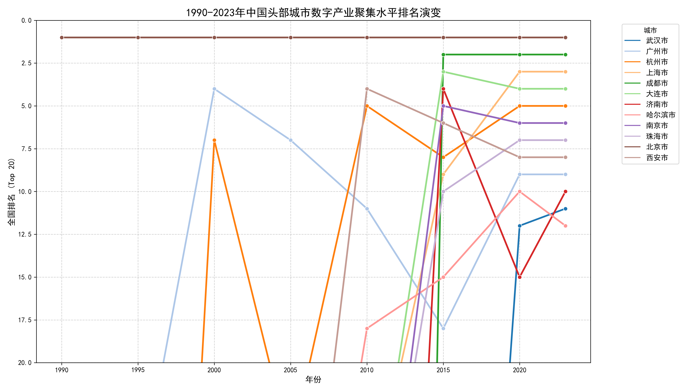
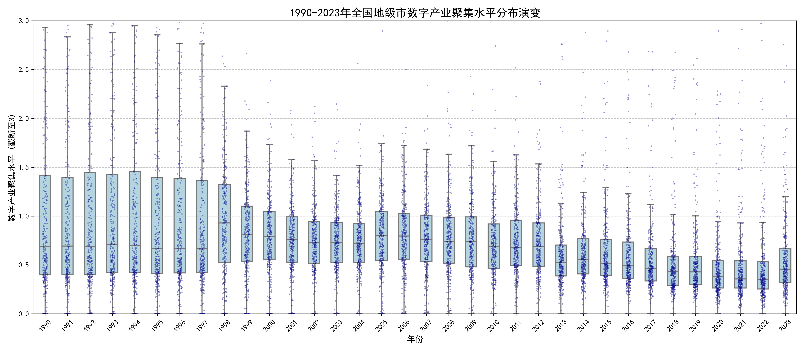

# Data Science Project: Spatiotemporal Evolution of China's Digital Industry Agglomeration (1990-2023)
**Author:** Wang He (MC660942)

## 1. Problem or Research Question
How has the agglomeration level of China's digital industry evolved over the past three decades? Is the development becoming more balanced across cities, or is it increasingly concentrating in a few leading cities (the Matthew Effect)?

## 2. Dataset Source and Usage Permissions
The dataset contains panel data of digital industry agglomeration levels (Location Quotient) for hundreds of prefecture-level cities in China from 1990 to 2023. It is used for academic and visualization purposes.

## 3. Methods and Tools Used
- **Language:** Python
- **Libraries:** Pandas, NumPy, Matplotlib, Seaborn
- **Data Cleaning:** Handled missing values using linear interpolation grouped by city. Excluded cities with historical administrative divisions abolished (e.g., Chaohu, Laiwu) to maintain data consistency.
- **Visualization:** Bump Chart (Tracking Top 12 cities' rank changes) and Boxplot with Stripplot (Showing the overall distribution and polarization trend).

## 4. Key Findings and One Limitation
- **Key Findings:** 
  1. **Extreme Head Effect:** Beijing has maintained absolute dominance (Rank 1) for 34 years. Shenzhen, Shanghai, and Hangzhou have also consistently remained in the top tier, showing a clear "Matthew Effect".
  2. **Polarization:** The boxplot reveals a widening gap. While the median remains relatively low, the distance between the bottom and top cities has expanded significantly over time, indicating a severe "digital divide" between leading and lagging cities.
- **One Limitation:** The "Agglomeration Level" (Location Quotient) can be extremely high for cities with a small overall employment base but a highly specialized digital sector, which might skew rankings in earlier years.

## 5. Instructions for Running the Analysis
1. Clone this repository.
2. Ensure you have the required libraries: `pip install pandas matplotlib seaborn openpyxl`.
3. Open the Jupyter Notebook `digital_industry_wanghe_mc660942.ipynb`.
4. Run all cells to generate the visualization charts.

## 6. Visualizations
### A. Top City Ranking Evolution

*Figure 1: Evolution of top cities' rankings from 1990 to 2023.*

### B. Distribution of Agglomeration Levels (Polarization)

*Figure 2: Distribution changes of digital industry agglomeration across all cities, indicating widening gaps.*
